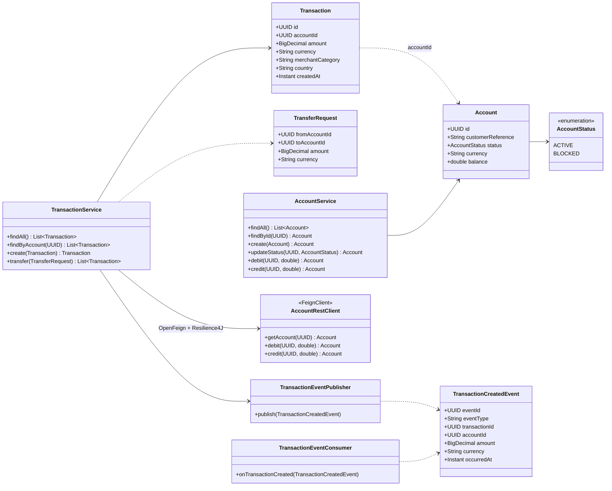
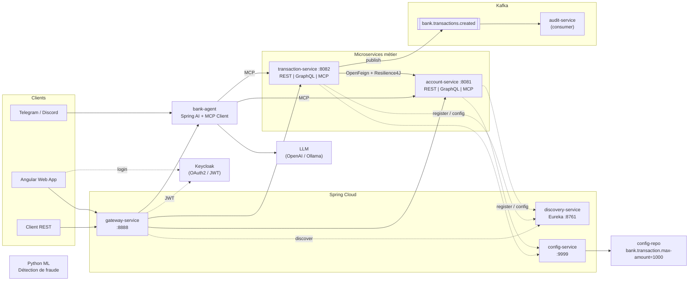

# Partie B — Conception et Architecture

## 1. Diagramme de classes



## 2. Schéma d'architecture



### Couches de chaque microservice métier

```
domain/        -> entités JPA
repository/    -> Spring Data JPA
service/       -> logique métier (règles)
web/rest/      -> @RestController   ┐
web/graphql/   -> @QueryMapping     ├─> appellent le même service
mcp/           -> @Tool (MCP)       ┘
```